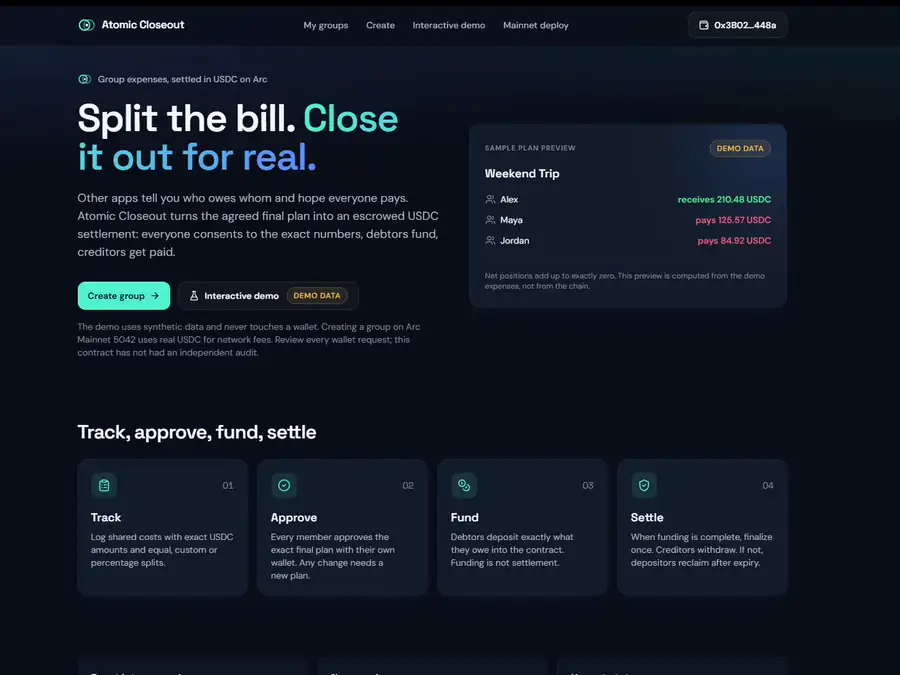
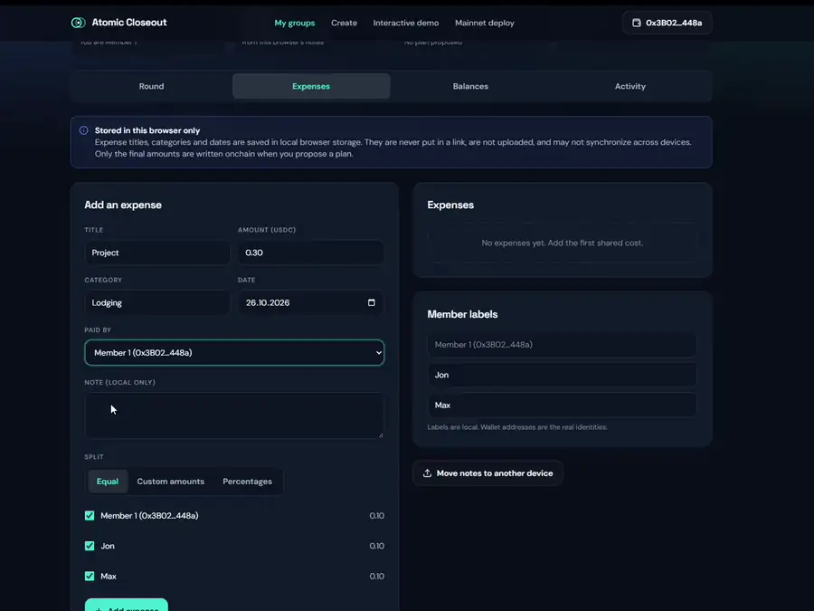
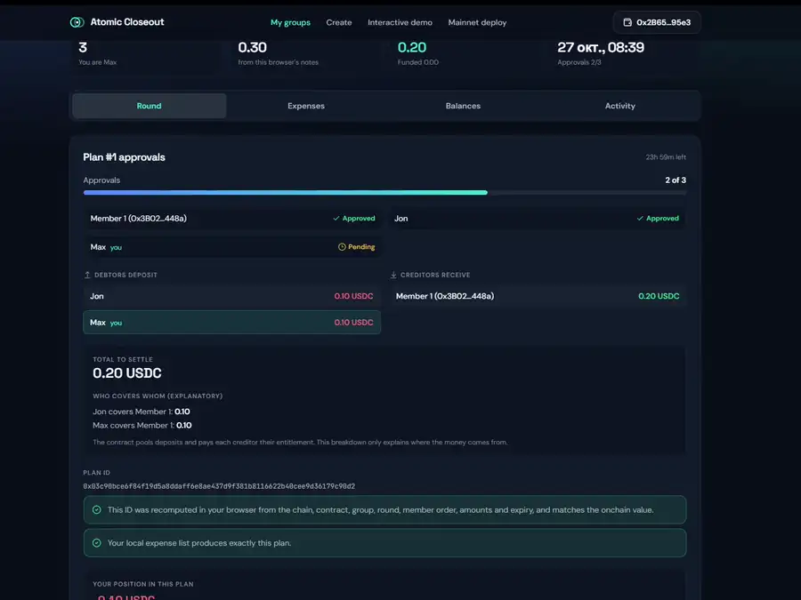
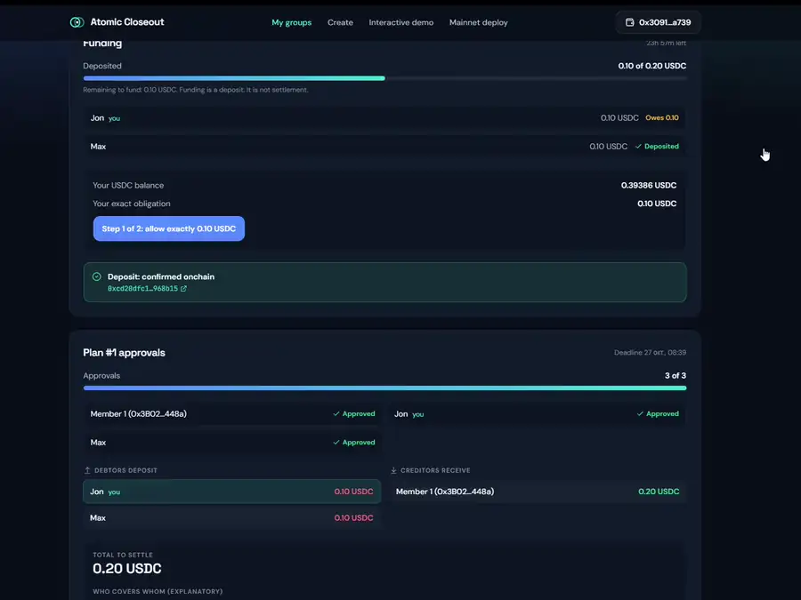
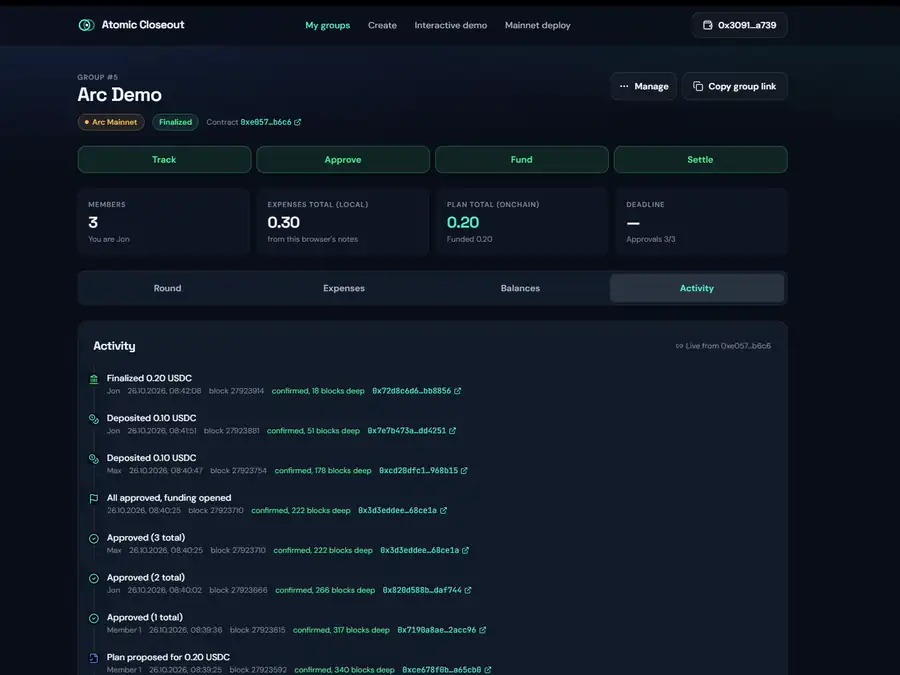
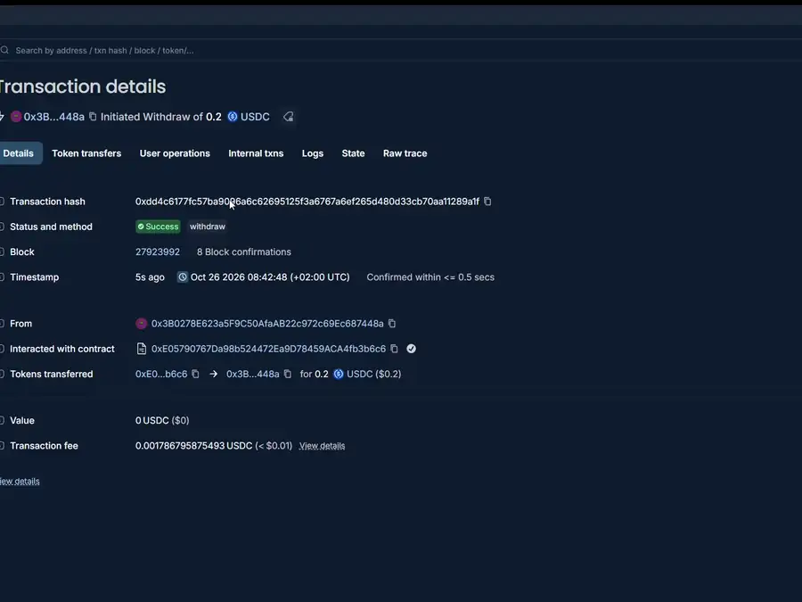
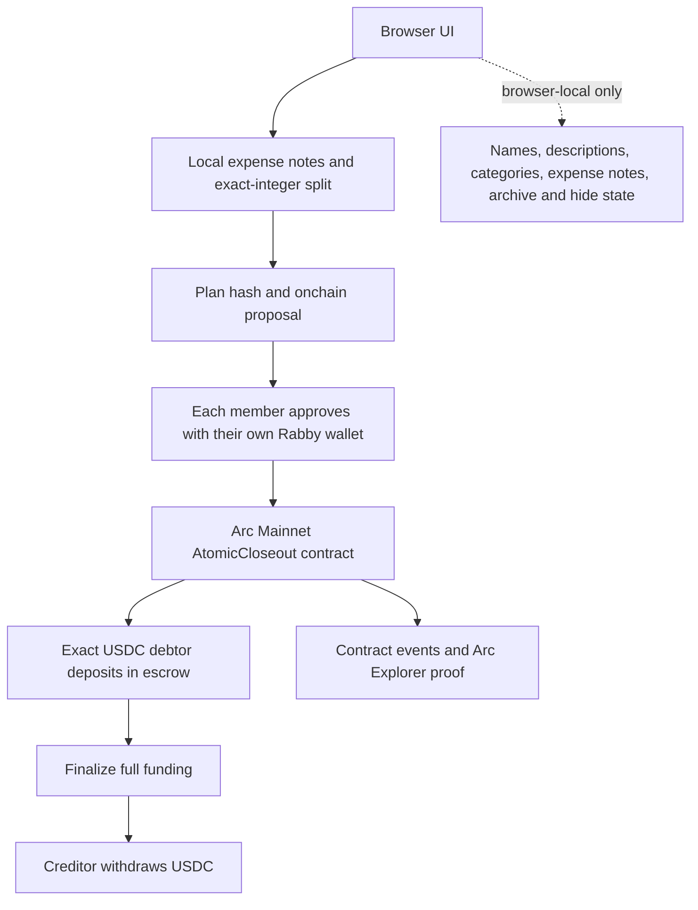

<div align="center">

# ATOMIC CLOSEOUT

### Split the bill. Close it out for real.

**Built with [Arc Studio](https://studio.arc.io/app/c6e2330d-8e2f-44aa-935c-a9859f922a5e?thread=fe457d3b-009c-4455-8cd0-7944598e9009). Powered by USDC on Arc Mainnet.**

Shared expenses become one plan that every member approves. Debtors deposit exactly what they owe; creditors withdraw only after the group is fully funded. If the deadline passes without full funding, depositors can reclaim their own money.

[**LIVE DEMO ↗**](https://arc-atomic-closeout.vercel.app/) · [**WATCH DEMO VIDEO ↓**](#watch-the-full-demo) *(public URL pending)* · [**ARC STUDIO ORIGINAL ↗**](https://studio.arc.io/app/c6e2330d-8e2f-44aa-935c-a9859f922a5e?thread=fe457d3b-009c-4455-8cd0-7944598e9009)<br />
[**GITHUB SOURCE ↗**](https://github.com/jayrayeducation/arc-atomic-closeout) · [**MAINNET CONTRACT ↗**](https://explorer.arc.io/address/0xe05790767da98b524472ea9d78459aca4fb3b6c6) · [**MAINNET EVIDENCE ↓**](docs/MAINNET_EVIDENCE.md)



*Capture from the owner's 6:08 screen recording. The landing-page sample card is labelled DEMO DATA; the Arc Demo transactions below are real Mainnet transactions.*

</div>

## See it work

**[Open the live app](https://arc-atomic-closeout.vercel.app/)** · **[Open Arc Demo, Group #5](https://arc-atomic-closeout.vercel.app/#/g/5042/5)** · **[Run the wallet-free Interactive Demo](https://arc-atomic-closeout.vercel.app/#/demo)**

The Interactive Demo is synthetic and clearly marked. **Arc Demo** is a separate, completed three-wallet settlement on Arc Mainnet: Group **#5**, Round **#3**, 0.20 USDC funded and 0.20 USDC withdrawn. Its nine transaction receipts and the current contract state were checked through read-only Arc RPC. [Inspect the evidence](docs/MAINNET_EVIDENCE.md).

### From the real Arc Demo recording

**Split the expense** — local notes become exact member shares, then a proposed onchain amount.



**One plan, three approvals** — each wallet approves the same plan ID.



**Fund, finalize, withdraw** — the UI keeps deposits, finalization and payout distinct.



<details>
<summary>See the Activity timeline and final withdrawal preview</summary>





</details>

All six animated WebP previews were cut from `Atomic_Closeout_Final_Demo.mp4` (the owner's real 2026-10-26 recording). They are visual excerpts, not substitutes for receipt verification. The full MP4 is **not** committed to GitHub.

## The problem

A group can agree on a spreadsheet balance and still have no shared commitment to the numbers or the payments. A payment alone does not show which expense plan everyone accepted. The awkward last mile is getting every person to consent, pay the right amount, and see that the closeout actually finished.

## The solution

Atomic Closeout gives small groups a single path from shared costs to a verifiable closeout:

1. **Track locally.** Enter expenses in USDC; split equally, by custom amounts or percentages. Exact integer arithmetic assigns any remainder deterministically.
2. **Propose onchain.** Net the group into debts and credits. The plan ID binds the chain, contract, group, round, member order, amounts, deadline and expense commitment.
3. **Approve individually.** Every member approves that exact plan using their own wallet. The contract opens funding only after unanimous approval.
4. **Fund precisely.** Each debtor deposits their exact obligation into the contract's USDC escrow. The app requests a debt-sized token allowance when more allowance is needed; a deposit is not a payout.
5. **Close out.** Full funding permits finalization. Each creditor then withdraws their entitlement in a separate transaction. If funding fails by the deadline, each depositor can refund only their own deposit.

This is the difference from a balance tracker: the **agreement, escrow state and payout history** are independently inspectable onchain.

## Why Arc + USDC

The product settles in the same USDC unit people used to record the expenses. Arc Mainnet is chain **5042**; the app uses the Arc USDC ERC-20 interface at `0x3600000000000000000000000000000000000000` with **6-decimal accounting**. Arc also uses USDC for network fees, shown separately from the escrowed amount. The contract accepts no native value. [Arc connection guide](https://docs.arc.io/integrate/connect-to-arc) · [USDC event reference](https://docs.arc.io/integrate/infrastructure/indexing-events).

## Real Mainnet evidence

**Arc Demo: Group #5 / Round #3.** The contract was deployed separately by the owner at block **27,856,267**. All nine Arc Demo transactions below have successful receipts, the expected decoded contract calls and events, and the same group/round linkage. The two deposits and withdrawal also have matching USDC `Transfer` logs. UTC date: **2026-10-26**.

| Action | Amount / result | Verified Arc Explorer transaction |
|---|---:|---|
| Create Arc Demo | Group #5; 3 members | [0x006e…9d02](https://explorer.arc.io/tx/0x006edcf63759ca302a2b86556056c31df3396d3f5daffe26e7cf55a35f0e9d02) |
| Propose plan | 0.20 USDC | [0xce67…5cb0](https://explorer.arc.io/tx/0xce678f0b3341e126fc3b5252e3f4e984644ca4e99882d9f273d6d5cb66a65cb0) |
| Approval 1 / 3 | Same plan ID | [0x7190…cc96](https://explorer.arc.io/tx/0x7190a8ae129414490db66ddd576f4a25c7e6d3ee9908a084f0e5bc13422acc96) |
| Approval 2 / 3 | Same plan ID | [0x820d…f744](https://explorer.arc.io/tx/0x820d588b0f59c9ddfe9e9b952ba6f0144f67877847bf922bd12715b656daf744) |
| Approval 3 / 3 | Funding opens in this transaction | [0x3d3e…ce1a](https://explorer.arc.io/tx/0x3d3eddeebe19bef927ab92699f3050e7ff49d68fdbfb1a9a56ebf6d7f068ce1a) |
| Max deposits | 0.10 USDC | [0xcd20…8b15](https://explorer.arc.io/tx/0xcd20dfc1c05646b570e2f2c7098e343489867b155a672604605311f146968b15) |
| Jon deposits | 0.10 USDC | [0x7e7b…4251](https://explorer.arc.io/tx/0x7e7b473a6fe9a42faaee6c28d379f69416e2fc3c2a331e1441dc83b4c9dd4251) |
| Finalize | 0.20 USDC entitlement | [0x72d8…8856](https://explorer.arc.io/tx/0x72d8c6d6828678c57092fd52c351d842554fece6d2b7b3e37a4276f818bb8856) |
| Creditor withdraws | 0.20 USDC transferred | [0xdd4c…89a1](https://explorer.arc.io/tx/0xdd4c6177fc57ba9096a6c62695125f3a6767a6ef265d480d33cb70aa11289a1f) |

The current read of Round #3 reports **Settled; 0.20 funded; 0.20 withdrawn**. [Full evidence, blocks and UTC timestamps](docs/MAINNET_EVIDENCE.md) · [machine-readable record](docs/mainnet-evidence.json) · [read-only verifier](scripts/verify-mainnet-evidence.mjs). ERC-20 allowance transaction hashes were **not supplied**, so their receipts are not claimed as verified.

The earlier **Atomic Closeout — Mainnet Demo** is **Group #1 / Round #1**, a separate completed 0.20 USDC run. Its current settled and fully withdrawn state was also checked by RPC; its transaction hashes are not mixed into the Arc Demo table.

## Watch the full demo

The owner has a **6:08** recording showing group creation, expenses, balances, proposal, three approvals, debtor allowances and deposits, finalization, withdrawal, Activity and Explorer proofs. **Public video URL: pending upload by the owner.** The six previews above come from that recording. No unlisted YouTube destination is implied.

Suggested fast walkthrough: open [Group #5](https://arc-atomic-closeout.vercel.app/#/g/5042/5), inspect **Round** and **Activity**, then follow the nine Explorer links. To explore controls without a wallet or USDC, use the clearly labelled [Interactive Demo](https://arc-atomic-closeout.vercel.app/#/demo).

## Architecture



**LOCAL** data stays in the browser and can be exported/imported. **ONCHAIN** data includes fixed member addresses and order, plan hash and amounts, approvals, deposits, finalization and withdrawal. The contract state is authoritative; editing local notes cannot rewrite an approved plan. Frontend: React 18, TypeScript, Vite, Tailwind, wagmi, viem and ConnectKit. Contract: Solidity 0.8.28, Foundry and OpenZeppelin.

## Built with Arc Studio

Atomic Closeout began as an [Arc Studio project](https://studio.arc.io/app/c6e2330d-8e2f-44aa-935c-a9859f922a5e?thread=fe457d3b-009c-4455-8cd0-7944598e9009). The exported project contains the original escrow contract, frontend, tests and testnet materials. Subsequent work on the export added browser-based mainnet safety, production configuration and group management. The **owner deployed the mainnet contract separately**; Arc Studio is credited for project origin, not for that deployment. [Provenance details](docs/ARC_STUDIO_PROVENANCE.md).

## Group management and safety

My groups has **Active / Archived / Hidden** views. Rename, description, member labels, expense edits and backups are local. Archive and Hide make no wallet request and do not delete blockchain history. A revised membership requires a **new group** because member addresses and order are fixed when the onchain group is created; the old group's funds and entitlements never move automatically.

**Early-stage prototype; no independent security audit.** Real USDC actions require wallet confirmation and network checks. Local expense notes do not automatically sync between devices. Blockchain history is immutable. The contract has no admin or upgrade path, but that is not a guarantee against bugs. Read [security notes](docs/SECURITY.md) before any use with funds.

## Reproduce locally

Node 22 and npm build the frontend. Foundry runs the contract tests. Bun is needed for the original settlement-model suite. A clean checkout uses the public deployment values pinned in `public-deployments.json`; `.env` is optional and must never contain secrets.

```bash
npm install --legacy-peer-deps
npm run dev              # http://localhost:5173
npm run check
npm run build
npm run contracts:test
npm run test:deploy
npm run test:groups
npm run test:pointer
node scripts/verify-mainnet-evidence.mjs   # read-only RPC; no wallet
```

To use another public RPC in PowerShell: `$env:ARC_RPC_URL = 'https://rpc.drpc.mainnet.arc.io'; node scripts/verify-mainnet-evidence.mjs`. Never place private keys or seed phrases in this workflow. The Interactive Demo needs no wallet. Real Mainnet actions use real USDC and network fees; review every wallet request.

## Verified tests

The latest local release checks passed: `npm run check`, `npm run build`, `npm run contracts:test` (**153 contract tests, 0 failures**), `npm run test:deploy`, `npm run test:groups` and Chromium `npm run test:pointer` at desktop and mobile widths with mock wallet/RPC and **zero real transactions**. The original `bun test tests` suite requires Bun; see [test notes](docs/TEST_REPORT_RU.md). Contract tests, mock browser tests and RPC receipt checks are distinct forms of evidence; none is an independent audit.

## Project links and credits

[Live app](https://arc-atomic-closeout.vercel.app/) · [Source](https://github.com/jayrayeducation/arc-atomic-closeout) · [Original Arc Studio project](https://studio.arc.io/app/c6e2330d-8e2f-44aa-935c-a9859f922a5e?thread=fe457d3b-009c-4455-8cd0-7944598e9009) · [Mainnet contract](https://explorer.arc.io/address/0xe05790767da98b524472ea9d78459aca4fb3b6c6) · [Mainnet evidence](docs/MAINNET_EVIDENCE.md) · [Security notes](docs/SECURITY.md)

Built with Arc Studio; developed further from the exported project by [jayrayeducation](https://github.com/jayrayeducation). Arc Mainnet deployment and the real-USDC demo were owner-run.
